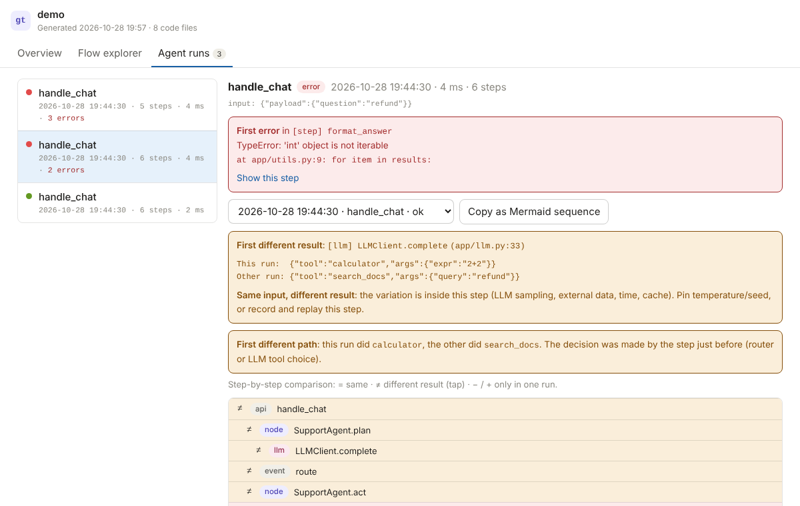
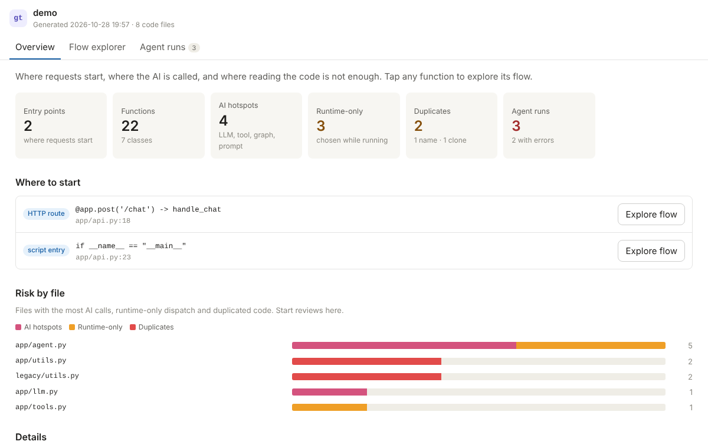
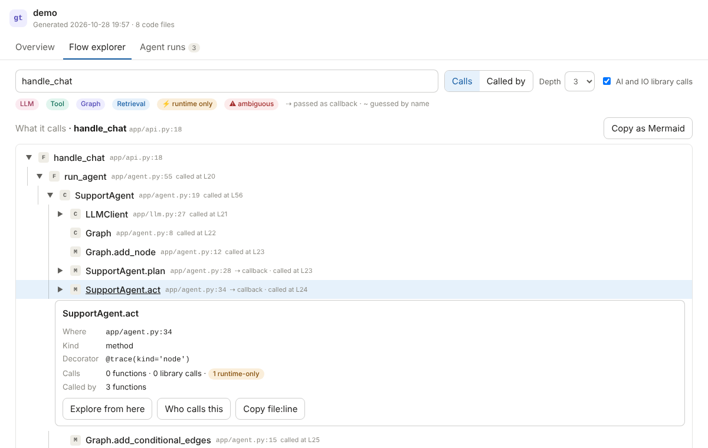
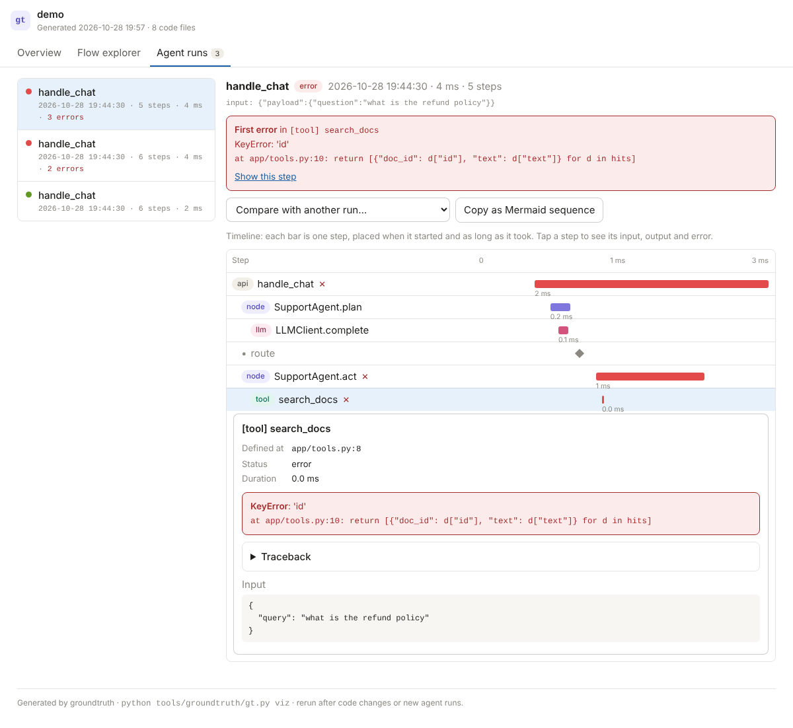
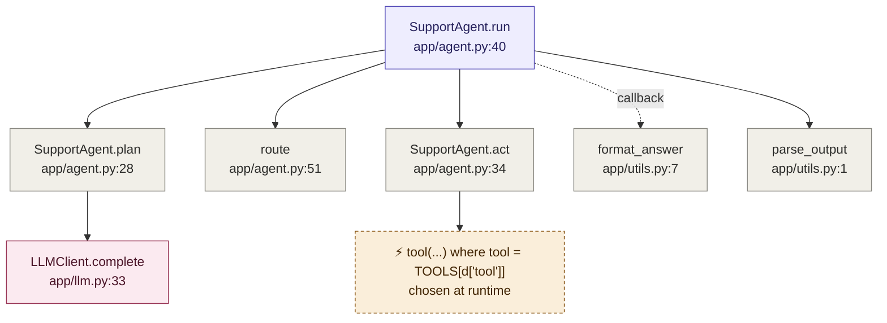

# groundtruth — debug AI-written code from evidence, not guesses

[](https://github.com/surajmhaske02/groundtruth-kit/actions/workflows/ci.yml)
  

A drop-in kit for any repo: shared rules + one skill + zero-dependency Python tools.
It makes Claude Code, Codex, Copilot, Cursor (and you) answer questions about an AI-written
codebase with **checked file:line evidence**, and makes **agentic / LLM flows debuggable**.



## Quick start

```bash
git clone https://github.com/surajmhaske02/groundtruth-kit.git
python groundtruth-kit/install.py /path/to/your/repo
cd /path/to/your/repo
python tools/groundtruth/gt.py viz --open
```

Then ask your agent: *"Use the groundtruth skill: explain the flow from `<your entry point>`."*

## Why agents hallucinate about your code

- Coding agents never "know" your repo. They grep, read a few slices, and act on that sample.
- When a fact they need isn't in the sample, the model fills the gap with what code *usually*
  looks like → invented functions, wrong files, flows that don't exist.
- They debug only as well as the feedback they get: a reproducible failure, tests, logs, traces.
  Without those, they guess — confidently.

So the fix is not a smarter prompt. It is: **make the truth cheap to get, and make guessing visible.**

## What's inside

| Layer | Piece | What it does |
|---|---|---|
| Rules | `AGENTS.md` (+ `CLAUDE.md` one-line import) | Cite `file:line` for every claim · label `[READ]`/`[RAN]`/`[INFERRED]` · "not found" is allowed · reproduce before fixing |
| Map | `gt.py map` → `docs/CODEMAP.md` | Entry points, LLM/tool/graph hotspots, dynamic dispatch, duplicate functions and renamed copy-paste clones |
| Navigate | `gt.py flow`, `gt.py callers` | Static call tree that follows callbacks, graph nodes, `self.x = Cls()` types, base classes, and flags what only runtime can tell. Callers include string/config references and dead code |
| Runtime truth | `agent_trace.py` + `gt.py trace` | Records every LLM call, tool call, node and decision. View a run as a tree; **diff two runs to find the first step where they diverge** |
| Verify | `gt.py verify` | Checks every `file:line`, symbol and quoted code block in an AI answer actually exists. Catches invented functions, wrong line numbers, wrong class, altered quotes, and fake locations in diagrams |
| See it | `gt.py viz`, `--mermaid` | An offline HTML report (overview, flow explorer, agent-run timelines with compare) and Mermaid diagrams generated from the code and traces, never hand-drawn |
| Protocol | `groundtruth` skill | Playbooks: explain a flow · debug · debug an agent · review AI code — all ending in a verification pass |

## Try it in 60 seconds

`examples/demo-agent` is a small, deliberately messy AI-style agent (duplicates, a renamed clone, registry
dispatch, a crashing tool, a nondeterministic "LLM") plus an AI answer full of invented facts.
Its README has the commands to run, including the visual report.

```bash
cp -r examples/demo-agent /tmp/demo && cd /tmp/demo && git init -q
python ~/groundtruth-kit/install.py .        # adjust the path to where you cloned the kit
SEED=1 python -m app.api refund ; SEED=0 python -m app.api refund
python tools/groundtruth/gt.py viz --open
```

| Overview | Flow explorer | Agent run timeline |
|---|---|---|
|  |  |  |

## Install (2 minutes)

```bash
python install.py /path/to/your/repo            # this repo
python install.py /path/to/your/repo --global   # + the skill for every repo on your machine
python install.py /path/to/your/repo --copy     # copies instead of symlinks (Windows without dev mode)
```

It adds (and never overwrites your existing content — re-running is safe):

```
AGENTS.md                      shared rules (appends a marked block if you already have one)
CLAUDE.md                      "@AGENTS.md" so Claude Code reads the same rules
tools/groundtruth/gt.py        map | flow | callers | verify | viz | trace
tools/groundtruth/agent_trace.py
tools/groundtruth/viz.py       the HTML report
.agents/skills/groundtruth/    the skill (+ bundled scripts)
.claude/skills/groundtruth  →  same skill for Claude Code
.github/skills/groundtruth  →  same skill for GitHub Copilot
docs/CODEMAP.md                generated map
docs/flows/_TEMPLATE.md        template for verified flow docs
.gitignore                     + .groundtruth/ (traces, cache and report stay local)
```

Then: **fill in the 5 "Project facts" lines at the top of `AGENTS.md`** and commit.

| Tool | Reads the rules from | Finds the skill in |
|---|---|---|
| Claude Code | `CLAUDE.md` → `@AGENTS.md` | `.claude/skills/` |
| OpenAI Codex | `AGENTS.md` | `.agents/skills/` |
| GitHub Copilot (VS Code, CLI, cloud agent) | `AGENTS.md` | `.github/skills/` |
| Cursor, Windsurf, Gemini CLI, Aider, Zed, … | `AGENTS.md` | ask: *"follow `.agents/skills/groundtruth/SKILL.md`"* |
| You, in any editor | — | run `gt.py` in the terminal |

## Daily use — prompts to paste into any agent

1. **Understand a flow**
   > Use the groundtruth skill. Explain what happens when `POST /chat` is called, from entry point to response. Write it to `docs/flows/chat.md`.
2. **Debug**
   > Use groundtruth (debug mode). `pytest tests/test_x.py::test_y` fails with `<error>`. Reproduce it, find the root cause with file:line evidence, fix minimally, rerun.
3. **Agent gives a wrong answer / picks the wrong tool**
   > Use groundtruth (agentic mode). For the input `"<question>"` the agent calls the wrong tool. Run it, read `gt.py trace view latest`, find the first wrong step and fix that layer.
4. **Review an AI-written PR**
   > Use groundtruth (review mode) on this branch's diff.
5. **Explain it with a picture**
   > Use groundtruth. Write `docs/flows/chat.md` for `POST /chat` with the Mermaid diagram from `gt.py flow --mermaid`, and mark which ⚡ boxes you confirmed at runtime.
6. **Check any AI answer yourself** — save it to `answer.md`, then
   `python tools/groundtruth/gt.py verify answer.md` (exit code 1 if anything is invented).

## Commands

```bash
python tools/groundtruth/gt.py map                          # rebuild docs/CODEMAP.md
python tools/groundtruth/gt.py flow handle_chat             # call tree (also Class.method or path/file.py:func)
python tools/groundtruth/gt.py flow app/agent.py:42         # tree for the function containing line 42
python tools/groundtruth/gt.py callers search_docs          # calls, callbacks, imports, string & config mentions
python tools/groundtruth/gt.py verify answer.md             # or:  ... verify -   (stdin)
python tools/groundtruth/gt.py trace list                   # recent agent runs
python tools/groundtruth/gt.py trace view latest [--errors] [--full]
python tools/groundtruth/gt.py trace show latest search_docs
python tools/groundtruth/gt.py trace diff latest~1 latest   # why did two runs behave differently?
python tools/groundtruth/gt.py viz [--open] [--out FILE]    # visual report (see below)
python tools/groundtruth/gt.py flow X --mermaid             # + trace view RUN --mermaid
```

## See it: visual report and diagrams

```bash
python tools/groundtruth/gt.py viz --open                  # → .groundtruth/report.html (offline, one file)
python tools/groundtruth/gt.py viz --out docs/report.html  # somewhere you can share it
python tools/groundtruth/gt.py flow handle_chat --mermaid  # call diagram
python tools/groundtruth/gt.py trace view latest --mermaid # sequence diagram of an agent run
```

The report has three tabs and works on a phone, in light and dark mode, with no internet:

| Tab | What you see | Use it to |
|---|---|---|
| Overview | Entry points, AI hotspots, runtime-only spots, duplicates, and a "risk by file" bar chart | Onboard, and decide where a review should start |
| Flow explorer | Search any function, expand **what it calls** or **who calls it**, colour-coded LLM / tool / graph / ⚡ runtime-only / ⚠ ambiguous; tap for details; copy the current view as Mermaid | Understand a flow in minutes; check blast radius before a change |
| Agent runs | A timeline per run (each bar = one LLM / tool / node step), the first error with its `file:line`, tap any step for input / output / traceback, **compare two runs** step by step | See why an agent failed, or why it works sometimes and not others |

Mermaid output renders on GitHub, GitLab, VS Code's Markdown preview, Notion and most docs tools, so diagrams
can go straight into `docs/flows/*.md`, PRs and issues. `gt.py verify` also checks the `file:line` labels inside
Mermaid blocks, so a hand-drawn diagram with invented locations gets caught.

Regenerate the report after code changes or new agent runs. For a 280k-line codebase it builds in about 13 s
(2.6 MB file) and stays instant in the browser.

## Instrument an agent (works with any framework or plain SDK calls)

```python
from tools.groundtruth import trace, run, span, event   # or copy agent_trace.py into your package

@trace(kind="llm")
def call_model(messages): ...

@trace(kind="tool")
async def search_docs(query): ...

@trace(kind="node")
def plan(state): ...

event("route", next=next_node)              # record decisions
with run("support question", input=q):      # optional grouping; runs start automatically otherwise
    agent(q)
```

Sync, async, generators and async streams are supported. Arguments named like `api_key`/`token`/`password`
and key-shaped strings (`sk-…`, `ghp_…`, `AKIA…`, JWTs) are masked. `GT_TRACE=0` turns it off.

## What it looks like (real output from `examples/demo-agent`)

Generated with `gt.py flow SupportAgent.run --depth 2 --mermaid` — GitHub renders it right here:




```text
$ gt.py flow SupportAgent.run --depth 2
SupportAgent.run  app/agent.py:40
├── SupportAgent.plan  app/agent.py:28
│   └── LLMClient.complete  app/llm.py:33
├── route  app/agent.py:51
├── SupportAgent.act  app/agent.py:34
│   └── ⚡ DYNAMIC tool(...) where tool = TOOLS[d['tool']] — resolve at runtime
└── parse_output  app/utils.py:1

$ gt.py verify answer.md
  ❌ app/auth.py:12        file not found in repo
  ⚠️  app/agent.py:30       cited lines don't mention 'route'; `route` is defined at app/agent.py:51
  ❌ `validate_session`    not found anywhere in repo — likely hallucinated
  ⚠️  `Graph.run`           `Graph` exists but has no `run` — found: SupportAgent.run app/agent.py:40
  ❌ `requests.post`       `requests` is not imported, defined or used anywhere in this repo
  ⚠️  block 2 (python): only 2/3 lines match the repo — if presented as existing code it was altered

$ gt.py trace diff latest~1 latest
FIRST DIFFERENT RESULT (innermost): [llm] LLMClient.complete  (app/llm.py:33)
  A output: {"tool": "search_docs", ...}
  B output: {"tool": "calculator", ...}
  → SAME input, DIFFERENT result: nondeterminism inside this step. Pin temperature/seed or record & replay.
```

## Team habits that remove most of the pain

1. **One important flow → one flow doc** in `docs/flows/`, written by the agent with citations, reviewed by a human, updated when the flow changes.
2. **Every bug fix starts with a failing test** (or repro script). No repro, no fix.
3. **Every LLM call, tool and graph node is traced.** Debug agents by reading runs, not code.
4. **Ask for evidence tables, not explanations.** "Show me file:line for each step."
5. **Put the generated diagram in every PR that changes a flow** (`gt.py flow X --mermaid`), so reviewers see the wiring, not just the diff.
6. **Run `gt.py map` after merges** and glance at "Possible duplicates" — AI code accumulates near-copies, and you fix the one that doesn't run.
7. **Short agent sessions.** New task → new session. Long sessions get summarised and drift.

## Honest limits

- `flow` is static and name-based. It follows Python scoping, imports, `x = Cls()`, `self.x = Cls()`, type hints and base classes, and marks dynamic dispatch (`getattr`, registries, model-chosen routes) with ⚡/⚠ — those need a runtime check.
- Full call graph for Python. JS/TS, Go, Java, Kotlin, C#, Rust, Ruby, PHP, Swift, Scala get the symbol index, hotspots, `callers` and `verify` (regex-based, so less precise).
- Jupyter notebooks are listed, not indexed — move reusable logic into `.py` modules.
- `verify` proves references are **real**, not that the reasoning is **right**. `[INFERRED]` claims still need a human or a `[RAN]` check.
- `agent_trace` is for development. In production use OpenTelemetry-based tracing (Langfuse, Arize Phoenix, LangSmith, …) — same mental model.
- Speed: ~10 s per 300k lines for the first `map`; after that a per-file cache makes `flow`/`callers` sub-second.

Requirements: Python 3.8+ only (tested on 3.8 and 3.13). No packages to install. The report opens in any modern browser.
