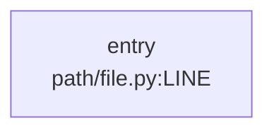

# Flow: <name>

> Verified: <YYYY-MM-DD> · Commit: <short sha> · By: <person or agent>
> Every row below cites code that was opened. `[RAN]` = confirmed at runtime.

## Purpose
One or two sentences: what triggers this flow and what it produces.

## Entry point
`path/to/file.py:LINE` — `function_name` (HTTP route / CLI command / job / agent run)

## Diagram
<!-- paste the output of: python tools/groundtruth/gt.py flow <entry> --mermaid -->

Mark the ⚡/⚠ boxes you confirmed at runtime in "Runtime-only parts" below.

## Steps
| # | What happens | Where | Evidence |
|---|---|---|---|
| 1 | Validates request, builds `state` | `app/api.py:41` | [READ] |
| 2 | Retrieves top-k docs | `app/retrieve.py:18` | [RAN] trace … |
| 3 | LLM decides next tool | `app/graph.py:77` | [RAN] |

## Data in / out
- In: shape of the input (key fields, types)
- Out: shape of the result

## Side effects
DB writes, external APIs, LLM calls (model + params), files, queues, caches.

## Failure points
| Where | What can go wrong | How it surfaces (error, log, silent?) |
|---|---|---|

## Runtime-only parts
Dynamic dispatch, registries, config/env-driven branches, model-decided routing —
and how each was confirmed.

## How to run and trace it
```bash
# command to run this flow locally
python tools/groundtruth/gt.py trace view latest
```

## Open questions
Things not yet verified, and the check that would settle each.
